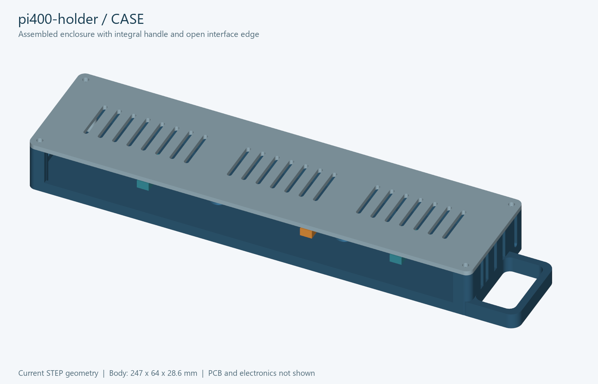
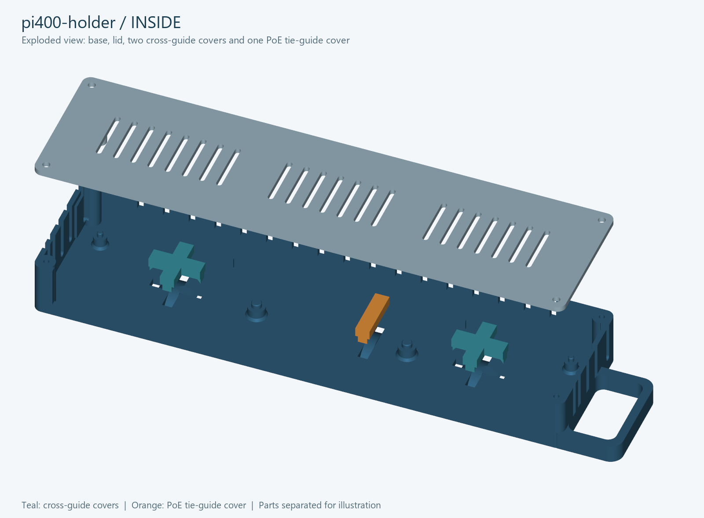

# pi400-holder

3D-printable Raspberry Pi 400 PCB case and modular rack holder.

Raspberry Pi 400의 PCB를 별도 케이스에 넣고, 같은 4개용 거치대를 반복 연결하는 프로젝트입니다. PCB와 별도 소형 방열판을 사용하며 순정 키보드 케이스·금속 방열판을 넣는 구조는 아닙니다.

## 케이스 미리보기

현재 설계의 실제 CAD 형상입니다. PCB와 전자 부품은 생략했습니다.





분해도에서 청록색은 십자 가이드 덮개 2개, 주황색은 PoE용 일자 가이드 덮개입니다. 부품 간 거리는 내부를 보여주기 위해 벌려 놓았습니다.

## 파일 구성

| 폴더 | 내용 |
| --- | --- |
| `source/` | CadQuery 설계 원본과 `design_parameters.json` 치수 |
| `STEP/` | CAD 편집용 부품과 조립 모델 |
| `STL/` | 출력 방향으로 배치한 부품 |
| `previews/` | 구조 미리보기 |
| `verification/` | 형상·치수 검사 결과 |
| `reference/` | 원래 실측표와 참고 모델; 과거 수치는 최신 설계값과 다를 수 있음 |

출력 수량과 조립 방법은 [START_HERE_KO.txt](START_HERE_KO.txt)를 참고하세요. STL의 단위는 mm이며 100% 크기로 출력합니다. 출력 설정을 포함한 Bambu Studio `.3mf` 프로젝트는 별도 저장해야 합니다.

## Pi 8대 구성

| STL | 수량 |
| --- | ---: |
| `01_case_base.stl` | 8 |
| `02_case_lid.stl` | 8 |
| `03_cross_guide_cap_print_2.stl` | 16 |
| `04_single_guide_cap_print_1.stl` | 8 |
| `05_quad_dock_repeatable.stl` | 2 |
| `06_gap_filling_connector.stl` | 1 |

`08_depth_link_optional.stl`은 앞뒤 방향 확장용입니다. 4개용 거치대는 273 × 216.8 × 22.5mm이며 Bambu Lab H2S 기준으로 확인했습니다. 두 장을 연결하면 전체 폭은 439.2mm입니다.

## 현재 주요 치수

- 거치대 벽 안쪽 간격: 247mm.
- 가이드 턱 안쪽 간격: 29.1mm. 중앙 받침과 턱 사이 틈은 바닥 기준 10mm까지만 채움.
- 손잡이 반대쪽 양각: 1.6mm. 손잡이 쪽 둥근 돌출부: 1.2mm.
- 연결부: 아래에서 위로 M2.5 볼트 삽입. 머리 홈 Ø4.5 × 2.7mm, 너트 홈 대변 5.1 × 깊이 1.8mm.
- PCB 두께: 1.2mm. 2026-10-20 수정: 손잡이에서 먼 큰 기둥(B)을 손잡이 반대쪽으로 0.5mm 추가 이동했습니다. 가까운 큰 기둥(C)은 유지합니다. PCB 기준 B X=82.7mm, C X=153.2mm, 두 Y=25mm. 구멍 기준 지름은 모두 4.9mm, 출력 핀 지름은 모두 4.6mm입니다.

PCB 치수는 사용자 실측과 사용자 지정 수정값입니다. 공식 PCB 기구 도면에 의해 검증된 수치가 아닙니다. 2026-10-25 사용자가 최신 파일을 출력한 뒤 모든 부분이 정확히 맞는다고 확인했습니다. 손잡이에서 먼 큰 기둥을 0.5mm 옮긴 최종 PCB 기둥 위치도 실물 맞춤 확인을 마쳤습니다. 확인한 파일과 해시는 [실물 출력 확인 기록](verification/physical_fit_confirmation.json)에 보관합니다. 기존 자동 검사 보고서의 실물 시험 여부는 이 확인 이전의 상태입니다.

## 재생성

Python과 CadQuery 2.8을 사용합니다. 검사·미리보기에는 `trimesh`, `numpy`, `rtree`, `vtk`, `Pillow`도 필요합니다.

```sh
python source/build_all.py
python source/check_case.py
python source/check_repeatable_connection.py
python source/check_package.py
python source/render_case_preview.py
```

설계 원본과 STEP/STL을 함께 보관합니다. 이전 출력물·가상환경·ZIP 백업은 저장소에 포함하지 않습니다. 참고 자료의 원문 설명은 `reference/reference-readme.md`에 남겨 두었습니다.
